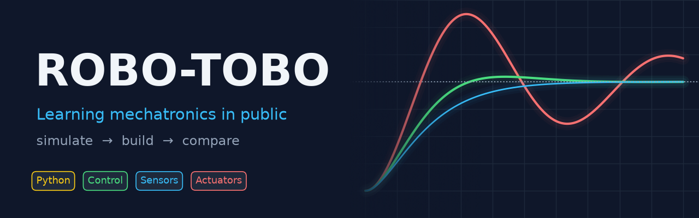
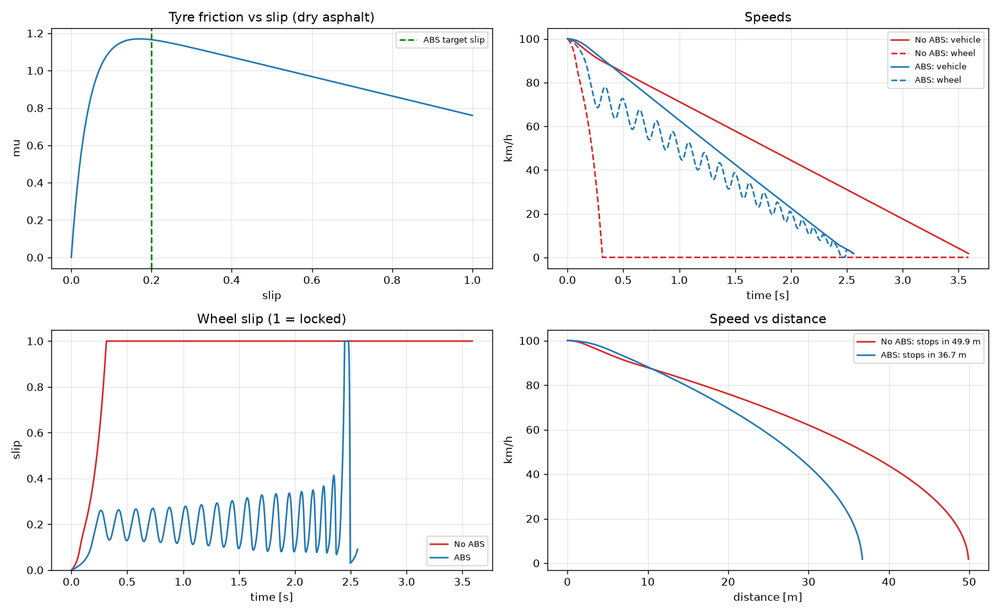
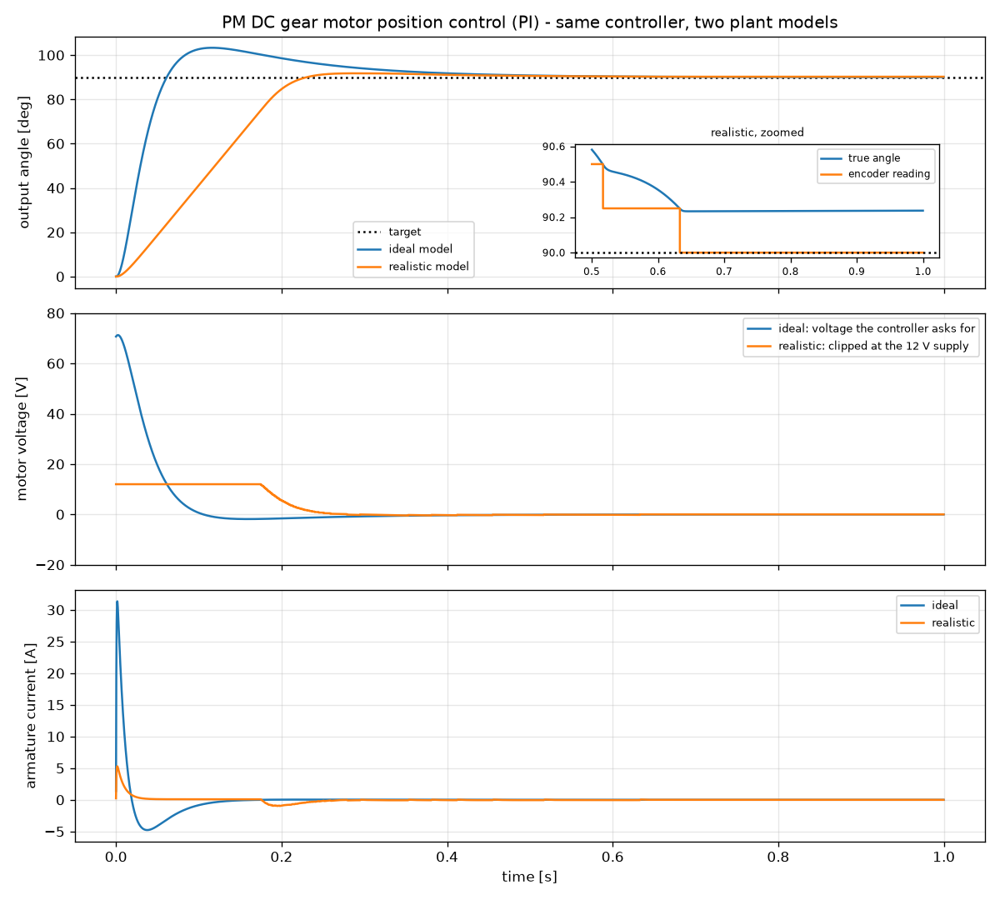
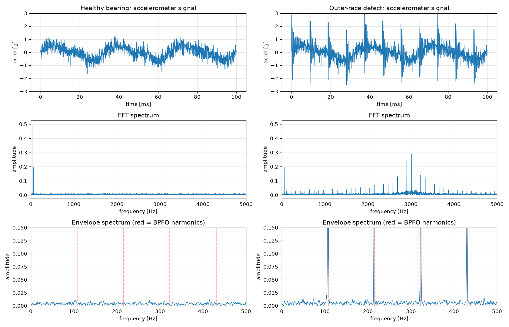
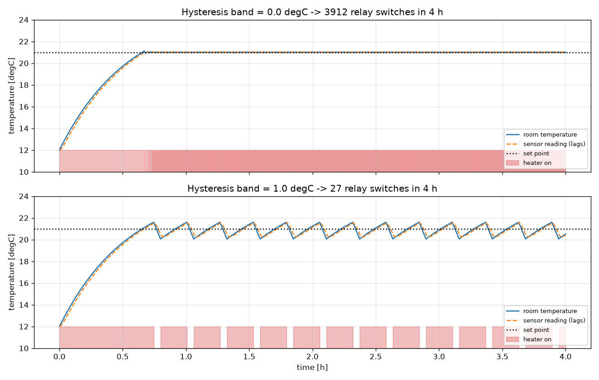

<p align="center">
  
</p>

<p align="center">
  
  
  
  
  
  
</p>

<p align="center">
  <b>Working through <i>Mechatronics System Design</i> one chapter at a time:<br>
  every concept turned into a runnable simulation, then built on real hardware.</b>
</p>

---

## 🧭 The idea

Mechatronics is the design of mechanics, electronics, sensors and control **together**, not one after another. The best way to learn it is to build it. Each chapter goes through three stages:

| | Stage | What happens |
|:-:|---|---|
| 🧮 | **Simulate** | Model the chapter's systems in Python and explore them by changing parameters |
| 🔧 | **Build** | Put the same system on real hardware (microcontroller, sensors, motors) |
| 📊 | **Compare** | Compare the measurements with the model and work out what the model missed |

## 🗺️ Roadmap

| # | Chapter | Simulation | Hardware |
|:-:|---|:-:|:-:|
| 1 | [Mechatronics System Design](chapter01/) | ✅ 8 sims | 🔜 |
| 2 | Modeling and Simulation of Physical Systems | ⬜ | ⬜ |
| 3 | Sensors and Transducers | ⬜ | ⬜ |
| 4 | Actuating Devices | ⬜ | ⬜ |
| 5 | System Control: Logic Methods | ⬜ | ⬜ |
| 6 | Signals, Systems and Controls | ⬜ | ⬜ |
| 7 | Signal Conditioning and Real-Time Interfacing | ⬜ | ⬜ |
| 8 | Case Studies | ⬜ | ⬜ |

## ✨ Chapter 1 highlights

<table>
  <tr>
    <td width="50%">
      
      <p align="center"><b>🚗 ABS braking</b><br>A locked wheel stops in <b>49.9 m</b>; ABS stops in <b>36.7 m</b></p>
    </td>
    <td width="50%">
      
      <p align="center"><b>⚙️ DC motor position control</b><br>The ideal model asks for <b>71 V</b>; the real supply has <b>12 V</b></p>
    </td>
  </tr>
  <tr>
    <td width="50%">
      
      <p align="center"><b>🔧 Bearing fault detection</b><br>The envelope spectrum finds the crack at <b>107.5 Hz</b></p>
    </td>
    <td width="50%">
      
      <p align="center"><b>🌡️ Thermostat hysteresis</b><br><b>3,912</b> relay clicks become <b>27</b> with a 1 °C band</p>
    </td>
  </tr>
</table>

All 8 simulations, with what each one teaches, are listed in the [Chapter 1 README](chapter01/).

## 🚀 Quick start

```bash
git clone git@github.com:KamranUmer/ROBO-TOBO.git
cd ROBO-TOBO
python3 -m venv venv
source venv/bin/activate
pip install -r requirements.txt

cd chapter01
python 08_abs_braking.py
```

Each script prints its key numbers, opens an interactive plot, and saves a PNG to `figures/`. Set `NO_SHOW=1` to skip the plot window.

## 📁 Repository layout

```
ROBO-TOBO/
├── chapter01/            # Chapter 1 simulations
│   ├── 01_…08_*.py       #   one script per concept, numbered in reading order
│   ├── common.py         #   shared RK4 integrator + figure saving
│   └── figures/          #   generated plots
├── assets/               # README banner (+ the script that draws it)
├── tools/pdftext.swift   # extracts a chapter's text from the book PDF (macOS)
└── requirements.txt
```

## 📚 Reference

> Devdas Shetty & Richard A. Kolk, ***Mechatronics System Design***, 2nd Edition (SI), Cengage Learning, 2010.

The book is not included in this repository. The simulations are my own implementations of its concepts, examples and end-of-chapter problems.

---

<p align="center">
  Built by <a href="https://github.com/KamranUmer"><b>Kamran Umer</b></a> · ⭐ Star the repo to follow along
</p>
