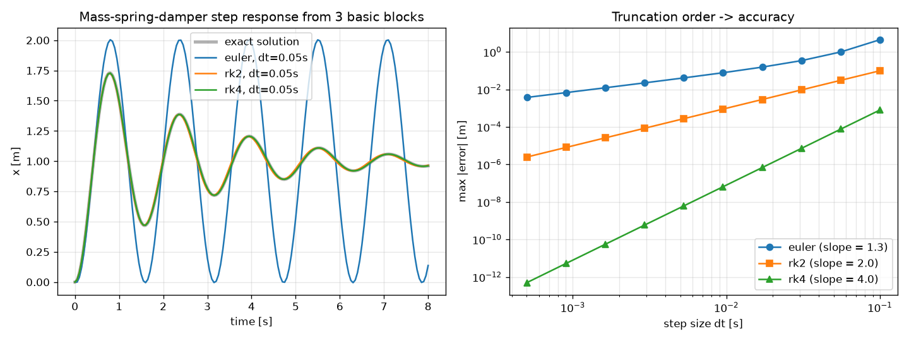
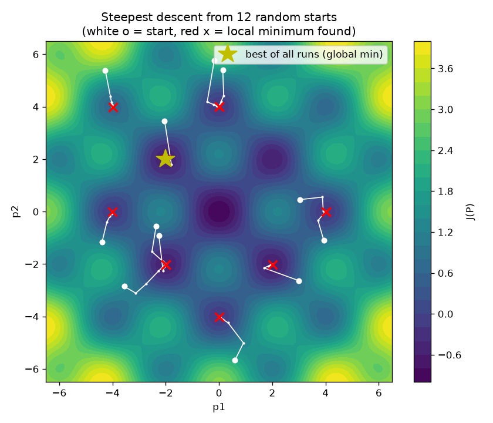
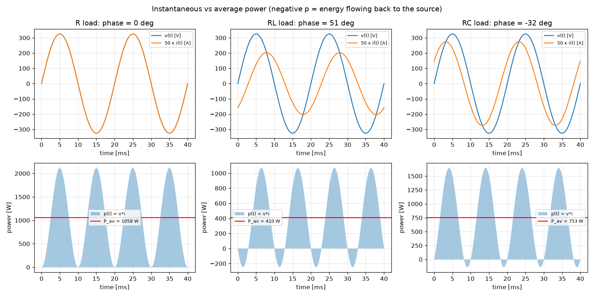
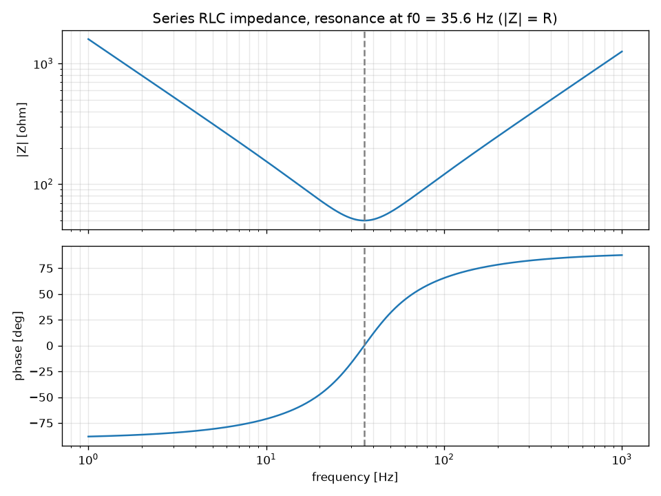
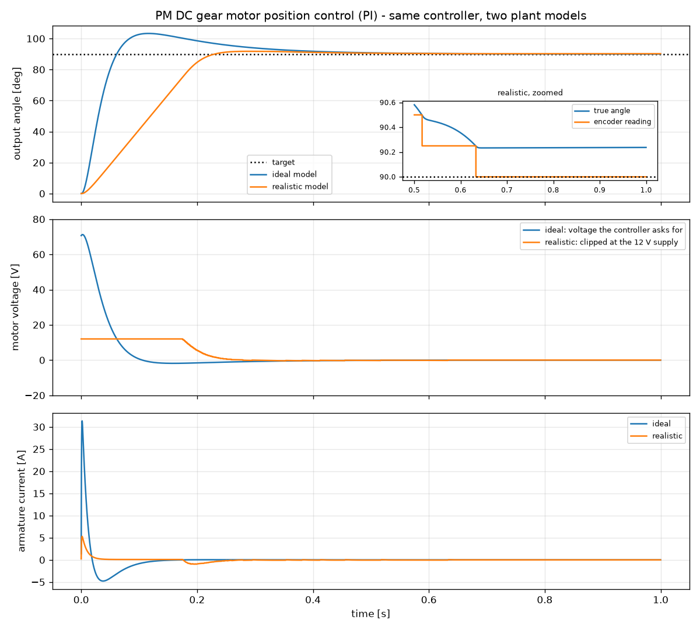
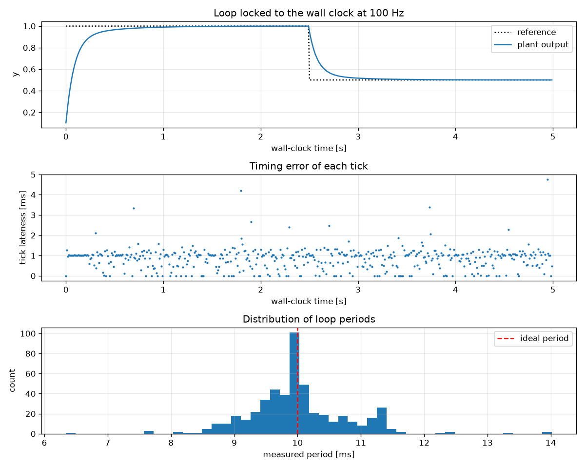
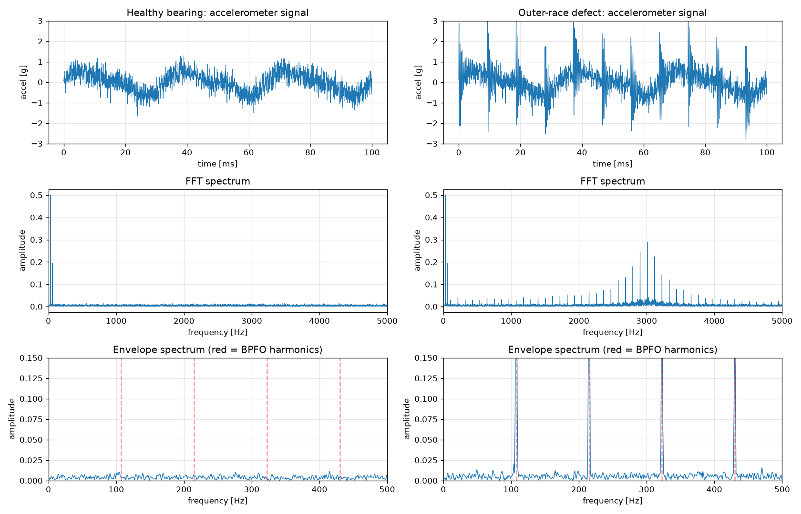
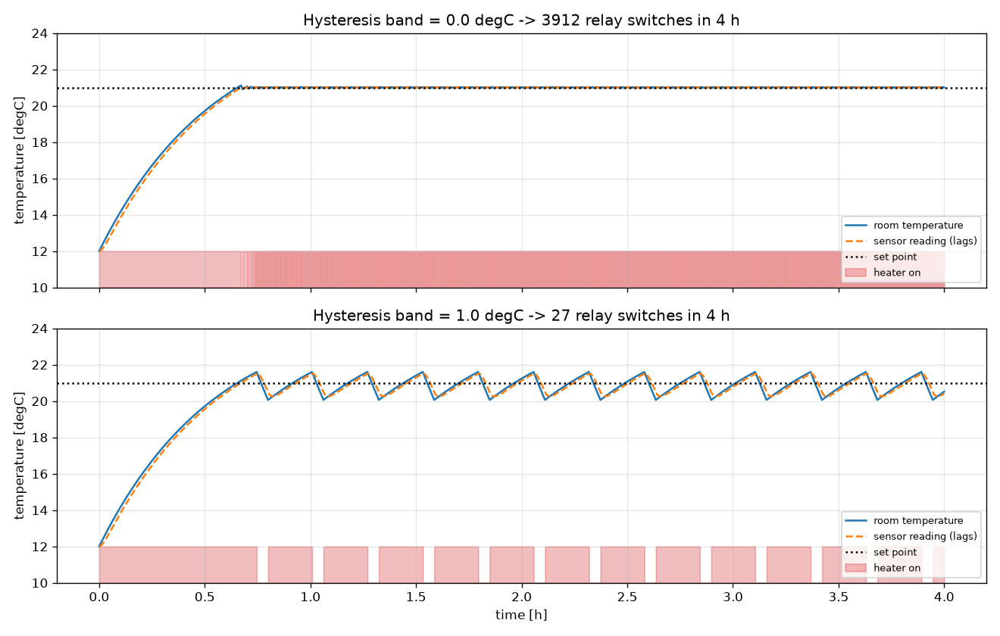
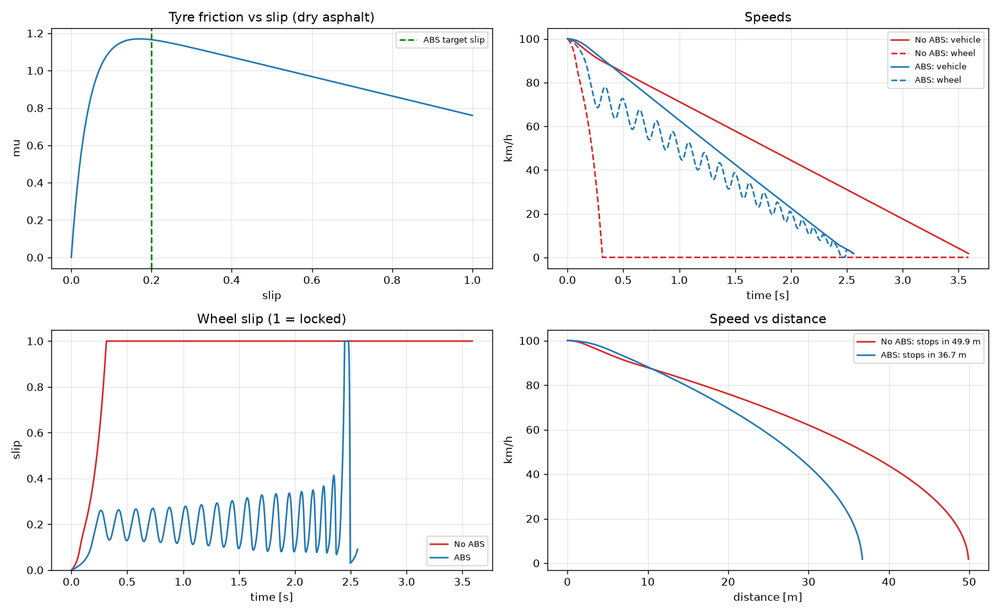

# Chapter 1 – Mechatronics System Design (simulations)

Book: *Mechatronics System Design*, Shetty & Kolk, 2nd ed. SI (PDF pp. 21–60).

Chapter 1 is mostly concepts, so each script turns one of those ideas into something you can run and change.

| Script | Book section | What you see |
|---|---|---|
| `01_block_diagram_sim.py` | 1.4.1, Fig 1-6 | A small block-diagram simulator built only from summing, gain and integrator blocks. It simulates a mass-spring-damper and compares Euler, RK2 and RK4 integration. |
| `02_optimization.py` | 1.4.1 Optimization | The book's luggage-volume problem solved numerically, plus the update P(k+1) = P(k) + t·S(k) run from many starting points to find local and global minima. |
| `03_electrical_power.py` | 1.4.3 | Impedance of R, L and C, instantaneous vs. average power, and the resonance of a series RLC circuit. |
| `04_dc_motor_position.py` | Example 1.1, Fig 1-27 | A PM DC gear motor with a Hall quadrature encoder and PI position control. It compares an ideal model with a realistic one that adds sampling, encoder counts, a 12 V supply limit and friction (the book's "unmodeled errors"). |
| `05_realtime_loop.py` | 1.3.2, 1.4.5 | Simulated time vs. wall-clock time, and the timing jitter of a 100 Hz loop on a normal operating system. This is the starting point for hardware-in-the-loop. |
| `06_condition_monitoring.py` | 1.5.1–1.5.2 | Accelerometer signals from a healthy and a cracked bearing, compared using RMS, kurtosis, the FFT and the envelope spectrum. |
| `07_temperature_control.py` | Problem 1.3(a) | A room heater with a thermostat. Without hysteresis the relay chatters; with a 1 °C band it switches far less. |
| `08_abs_braking.py` | Problem 1.3(b) | A quarter-car emergency stop with and without ABS, showing wheel lock and stopping distance. |

## Run

From the `RoboTobo` folder:

```bash
cd chapter01
../venv/bin/python 04_dc_motor_position.py
```

Each script prints its key numbers, opens a plot window and saves the plot to `figures/`. Set `NO_SHOW=1` to save the plot without opening a window.

## Things to try

- **01**: Increase `dt` until Euler blows up. RK4 stays stable much longer.
- **02**: Remove the side constraint on H and see the optimum turn back into a cube.
- **04**: Change `CPR` (encoder resolution), `V_MAX` or `Kp`/`Ki`. Turn off anti-windup and watch the overshoot.
- **07**: Increase `tau_sensor` (a slower sensor) and watch the temperature swing grow.
- **08**: Change the slip `target` from 0.2 to 0.1 or 0.4 and compare stopping distances.

## Gallery

| | |
|:-:|:-:|
| **01 · Block-diagram simulation** | **02 · Optimization** |
|  |  |
| **03 · Instantaneous vs average power** | **03 · Series RLC impedance** |
|  |  |
| **04 · DC motor position control** | **05 · Real-time loop timing** |
|  |  |
| **06 · Bearing condition monitoring** | **07 · Thermostat hysteresis** |
|  |  |
| **08 · ABS braking** | |
|  | |
